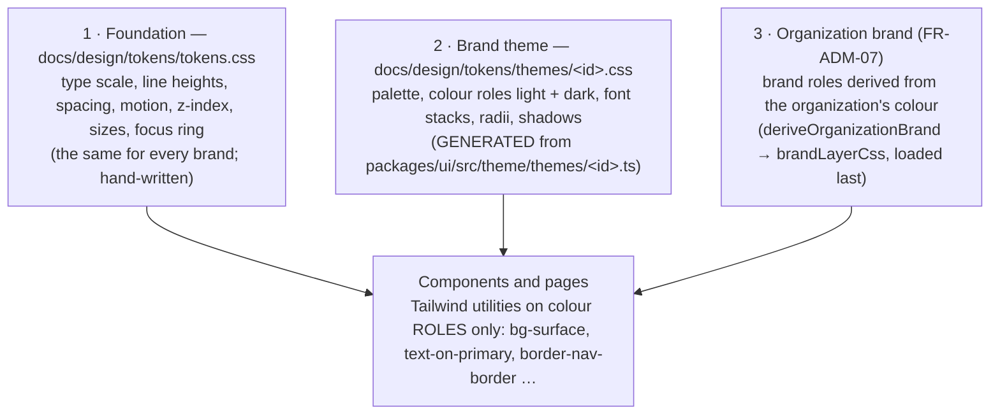

# Theming — how the look is built and swapped

| | |
|---|---|
| **Backlog** | T-M2-04c (visual design round — groundwork); **T-M2-21** (approved design «Meridian» with the Jadarat palette applied — PO, 14 Oct 2026) |
| **Requirements** | FR-ADM-07 (organization branding, R1), FR-ADM-08 (theme builder, R2), NFR-UX-01 (WCAG 2.2 AA), NFR-UX-04 (consistent design system), NFR-L10N-02 (Arabic typography) |
| **Status** | Shipped theme = the approved design (14 Oct 2026): «jadarat» in `themes/jadarat.ts`, gradient side navigation, self-hosted fonts. The «Jadarat LMS» slot stays pending (same values) |
| **Code** | `packages/ui/src/theme/` (exported as `@jadarat/ui/theme`), `docs/design/tokens/`, `packages/config/tailwind/preset.css`, Storybook «Theme preview» |

## 1. Three layers

- `packages/ui/src/styles.css` imports the foundation, then the shipped theme. **Swapping the look = generating another theme file and importing it there** (§4).
- All three layers set CSS custom properties with the same selectors (`:root` for light; `@media (prefers-color-scheme: dark) :root:not([data-theme="light"])` and `:root[data-theme="dark"]` for dark), so a later layer replaces exactly the properties it sets and dark always beats light.
- The Tailwind preset only *names* the colour roles (`@theme inline reference`): utilities compile to `var(--color-<role>)` and Tailwind keeps no copy of any colour value.
- `docs/design/tokens/tokens.json` (W3C DTCG) documents every token. Tests keep it equal to the CSS.

## 2. The contract

`packages/ui/src/theme/contract.ts` is what a theme must provide:

| Group | Roles (CSS `--color-<role>`) | Notes |
|---|---|---|
| Surfaces | `bg`, `surface`, `surface-raised`, `surface-sunken`, `surface-hover`, `surface-selected` | |
| Text and lines | `text`, `text-muted`, `text-subtle`, `text-disabled`, `border`, `border-strong` | `text-disabled` exempt from contrast; `border` decorative only |
| Primary | `primary`, `primary-hover`, `on-primary`, `primary-subtle`, `primary-text`, `focus-ring` | Buttons, current item, links in brand colour |
| Accent (slot) | `accent`, `accent-hover`, `on-accent`, `accent-subtle`, `accent-text` | Second brand colour; aliases of primary in «jadarat» |
| Status | `success*`, `warning*`, `danger*`, `info*` | Always with an icon and a word (design principles P3) |
| Inverse, scrim | `inverse-surface`, `inverse-text`, `overlay` | Toasts, tooltips; behind dialogs |
| Shell | `header`, `on-header`, `on-header-muted`, `header-border`, `nav`, `nav-end`, `on-nav`, `on-nav-muted`, `nav-border`, `nav-item-hover`, `nav-item-current`, `on-nav-item-current`, `nav-focus-ring` | Header: aliases of the surface/text roles (white top bar). Navigation: a gradient from `nav` (top) to `nav-end` (bottom) — «jadarat»: brand slate `#2F4858` → steel `#33658A`; `nav-focus-ring` is the ring inside it (Jadarat amber `#F6AE2D`) |

Plus font stacks (`--font-family-arabic|latin|mono`), radii (`--radius-sm|md|lg|xl`) and shadows (`--elevation-1…4`, light and dark).

**The shipped values (T-M2-21).** Light: text `#1F3340` / muted `#46596A` / subtle `#5F6F7C`, page `#F5F7F9`, surface `#FFFFFF`, hover `#EEF3F7`, hairline `#E0E6EB`, primary steel `#33658A` (hover `#2A5574`, tint `#EAF3F9`, brand text `#2B5677`), success `#16794A`, warning `#8A5300`, danger `#BE2A2F`; radii 4 / 6 / 8 / 12 px. One deliberate deviation from the mock-ups: the approved control border `#CBD5DD` is only 1.5 : 1 on white, so `border-strong` (inputs, secondary buttons — SC 1.4.11) is `#7A8A97` (3.3 : 1 on the page) and `#CBD5DD` (`neutral.300`) is decoration only. Navigation text is the approved white at 92 % / 85 % made opaque over the lighter gradient end (`#EFF3F6` / `#E0E8ED`), and the hover fill is opaque (`#437193`, 8 % white over steel) so every pair can be computed. Dark mode is slate-based with the same roles (navigation `#162430` → `#1E3D55`). Exact numbers: [`tokens/contrast-report.md`](tokens/contrast-report.md).

**Fonts.** Poppins (English/Latin), IBM Plex Sans Arabic (Arabic — first in the Arabic stack and for any element with `lang="ar"`, and the fallback for Arabic words in English text), IBM Plex Mono (codes). Self-hosted: `packages/ui/src/fonts.css` imports the `@font-face` rules of the `@fontsource/*` packages (OFL-1.1; weights 400/500/600), so Next.js and Storybook bundle the woff2 files — no font CDN (ADR 0007 §4 as amended 14 Oct 2026; notices in `packages/ui/THIRD_PARTY_NOTICES.md`).

Rules (all enforced by `packages/ui/src/theme/theme.test.ts`):

- every role has a light value; a role without a dark value must be an alias (`{semantic.<role>}`) so it follows its target in dark mode;
- every pair of `CONTRAST_PAIRS` (74 per mode: text 4.5 : 1, UI components and focus 3 : 1) passes in light and dark — [`tokens/contrast-report.md`](tokens/contrast-report.md) is generated from them; navigation text, the current pill and `nav-focus-ring` are checked against **both** gradient ends;
- the Tailwind preset names every role (so every role has its utilities);
- a theme with `status: 'pending'` (the «Jadarat LMS» slot) must keep the shipped values — nothing guessed before the PO's material arrives;
- `themes/jadarat.css` and `contrast-report.md` must equal what the code generates (CI fails when stale).

Components use roles, never palette steps or raw colours. Navigation entries use `NavGroup` / `NavItem` / `NavUnavailable` (shell roles), header text `text-on-header*`, so the navigation stays readable on any gradient. The gradient is the `bg-nav-gradient` utility (`packages/ui/src/styles.css`); inside the navigation (`data-nav-scope`) focus is a 2 px `nav-focus-ring` outline, 2 px away from the entry.

## 3. Organization brand colours (FR-ADM-07)

`deriveOrganizationBrand({ primary, accent? }, baseTheme)` returns a brand layer for light and dark, the list of `adjustments` and the full contrast check:

| Mode | Fill (`primary`) | Text on fill | Hover | Tint (`primary-subtle`, `surface-selected`) | Brand text, focus ring |
|---|---|---|---|---|---|
| Light | the colour, darkened only as much as needed for white text ≥ 4.5 : 1 and the fill ≥ 3 : 1 on the page | white | 18 % darker (lighter for near-black) | a 90 % white wash, lightened until all text reads on it | darkened until ≥ 4.5 : 1 on every light surface and on the tint |
| Dark | the colour, lightened as needed (a very dark shade of it as text) | very dark shade of the colour | 25 % lighter | a little of the colour on the dark surface | lightened until ≥ 4.5 : 1 on every dark surface and on the tint |

- **Side navigation (T-M2-21):** the organization's colour replaces the Jadarat gradient. Bottom (`nav-end`) = the colour (light: the button fill), darkened until near-white text passes on it and on its hover fill (8 % white over it); top (`nav`) = 30 % darker; text, muted text, a white current pill (pale in dark mode) with text in the dark shade, and the Jadarat amber focus ring — white when amber would be under 3 : 1 on either end. In dark mode the gradient starts from a deep shade of the colour. Example (approved mock-up): `#0F6E5A` → `#0B4D3F` → `#0F6E5A`.
- **Colours only:** organizations have no font choice (PO, 14 Oct 2026; BRD v2.9 FR-ADM-07). `brandLayerCss` writes `--color-*` roles only; anything else in a layer is ignored (tested).
- The result is re-checked against **all** pairs; a failure throws (by construction it cannot happen; the tests run ~530 colours: white, black, pure yellow, greys, a 216-colour grid and seeded random colours, with and without an accent).
- `adjustments` tells the admin preview when the colour shown differs from the one chosen (e.g. yellow `#FFD500` → `#8A7300` for buttons in light mode). The Storybook story «Theme preview / Colours and contrast» shows these notes.
- Only `#RRGGBB` values for known roles can be written (`normalizeHex`, `brandLayerCss`): tenant input can never inject CSS.
- **Built (WP-ADM-02, 23 Oct 2026; `docs/engineering/branding.md`):** the Branding page (primary + secondary colour, «Use gradient» — `gradient: false` makes the current entry one colour —, presets, a WCAG 2.2 AA warning on the colours as chosen, live preview with unsaved values through CSS custom properties set by the CSSOM), storage (`platform.tenant_branding`) and the layer in the app: the shell and the sign-in page render `brandLayerCss` in a `<style>` with the request's nonce. The e-mail colours are derived at save time and stored with the branding (§6 point 1).

## 4. Replacing the look (the visual round)

1. Fill `packages/ui/src/theme/themes/jadarat-lms.ts` with the values taken from the PO's material (palette, all roles light + dark, fonts, radii, shadows) and set `status: 'active'`.
2. `pnpm --filter @jadarat/ui exec vitest run src/theme` — fix any contrast failure (the report names the pair and the ratio).
3. Review in Storybook (`pnpm --filter @jadarat/ui storybook`): toolbar **Brand = Jadarat LMS**, Arabic/English, light/dark, «Theme preview» stories; publish the static build for the PO.
4. After PO approval: make it the shipped theme (`SHIPPED_THEME` in `packages/ui/src/theme/index.ts`, the generated file and the `@import` in `styles.css`), update `tokens.json`, then `vitest run -u` (the golden record and the contrast report show every changed value for review).
5. Work through [`visual-round-checklist.md`](visual-round-checklist.md) (fonts, links, form controls, shell adoption, e-mail).

## 5. Proving "no visible change"

- `packages/ui/src/theme/tokens.test.ts` keeps a golden record (snapshot) of every resolved token in 7 contexts (light/dark by app setting and by system, Arabic/English, reduced motion). A refactor must leave it unchanged; a look change shows every changed value in the diff.
- For the T-M2-04c groundwork the computed styles and screenshots of every Storybook story (4 modes) and 17 app routes (desktop and mobile, light and dark) were also compared before/after in a browser: 0 differences.

## 6. Open technical points (Tech Lead)

| # | Point | Proposal |
|---|---|---|
| 1 | E-mails cannot import `@jadarat/ui` (platform packages are UI-free, ADR 0001); `EMAIL_COLORS` in `packages/platform-notifications/src/layout.ts` repeats token values by hand | Move `src/theme` (pure TypeScript, no React) to a small UI-free package that both may import, or store the derived organization palette with the branding settings and pass it to the e-mail renderer |
| 2 | The theme test generates the CSS of the shipped theme only | Generate one file per active theme when a second theme ships |
| 3 | Links have no colour role: Tailwind's preflight makes them inherit the text colour, without underline | Decide the link style in the round (SC 1.4.1: links in text need more than colour) |
| 4 | ~~Fonts are not loaded at all yet~~ | Done (T-M2-21): `packages/ui/src/fonts.css`, see §2 |
